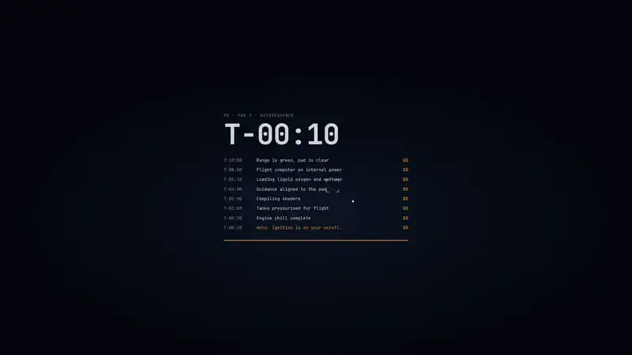

# Rocket Launch Portfolio

An immersive one-page portfolio where scrolling launches a rocket. The loader is a launch countdown, the
hero is a two-stage vehicle on the pad at night, and every section is one phase of the flight: liftoff,
max-Q, staging, fairing separation, orbit, an exploded view of the vehicle, and a booster landing at the
end. Everything is rendered live in WebGL with Three.js. The demo person, Nikhil Varma, and every company,
project and paper on the site are fictional. Replace them with your own by editing one file.

<p align="center">
  <a href="docs/preview.mp4"></a>
  <br>
  <sub>Click the preview to watch the full 40-second video (<code>docs/preview.mp4</code>).</sub>
</p>

**Use it:** click **Use this template** at the top of this page (or run `git clone https://github.com/Malaydoshi711/rocket-launch-portfolio-template.git`), then follow [Quick start](#quick-start) and [Make it yours](#make-it-yours) below. Everything you need to change lives in `src/data/content.ts`.

## Features

- **Countdown loader**: a sequencer log ticks from T-10:00 down to a hold ("Ignition is on your scroll")
  while the 3D scene builds, then the floodlights come on over the pad.
- **Scroll-driven flight**, one phase per section, with a live telemetry HUD (mission clock, altitude,
  velocity, downrange, dynamic pressure):

  | Section | Flight phase | What the 3D does |
  | --- | --- | --- |
  | Hero | Terminal count | Vehicle on the pad: service tower, crew arm, umbilicals, floodlights, venting vapour, frost on the tanks |
  | About | Liftoff | Ignition flash, plume with shock diamonds, smoke out of the flame trench, water deluge, frost falling off |
  | Experience | Max-Q | Climbing through the cloud deck with a condensation collar |
  | Flagship project | Staging | MECO, separation, the booster flips for boostback with grid fins out; the upper stage lights its vacuum engine |
  | Projects | Second stage burn | Vacuum plume over the curving Earth, with a horizontal reel of project cards |
  | Papers | Fairing separation | Fairing halves hinge open and drift away, revealing the payload |
  | Toolkit | Orbit insertion | Engine cutoff above the night side, sunrise on the limb, the target orbit traced in amber |
  | Vehicle | Breakdown | The stack assembles as an exploded view; each part maps to your projects (hover to highlight) |
  | Contact | Deploy and landing | The payload unfolds its solar wings, then the sooty booster lands back on its pad |

- **All procedural**: lathe and extruded geometry, canvas-drawn livery and concrete, custom shaders for
  the plume, smoke, clouds, Earth and atmosphere. No downloaded models, textures or HDRIs.
- **"Ask my agent" console**: a small retrieval agent that answers questions from your content, with a
  visible step trace. Works offline; can use an LLM if you configure one.
- **Ctrl/Cmd+K command palette**: jump to a section, download the resume, copy the email, open links,
  or type a question for the agent.
- Custom cursor, optional engine rumble (Web Audio, off by default), phone layout, reduced motion,
  WebGL fallback and adaptive quality.

## Quick start

Needs Node 20.19+ or 22.12+ (Node 22 LTS recommended).

```bash
npm install
npm run dev       # http://localhost:5173
npm run build     # type-checks, then builds to dist/
npm run preview   # serves the production build
```

Handy query flags while you work: `?nogl` shows the no-WebGL fallback, `?noadapt` turns off the automatic
quality drop.

## Make it yours

1. **Edit `src/data/content.ts`.** It is the only file with personal content. Its exports:
   - `profile`: name (split into `first` and `last` for the two hero lines), role, short tagline for the
     top bar, pronouns (used by the agent), location, email, intro, about paragraphs, small facts under
     the About heading, topics for search engines.
   - `site`: domain, page title, descriptions, locale, resume path and download name, social preview
     image, footer note, the `fictional` flag and your social links.
   - `mission`: the words painted on the 3D rocket and shown by the loader: company name in the hero
     kicker, the wordmark on the booster and fairing, vehicle name and tail numbers (used in the painted
     serials), pad name, the flag on the booster (stripes and optional wheel, or `null`), and the countdown
     lines of the loader.
   - `copy`: section headings and the short lines under them.
   - `experience`, `education`, `featured` (the flagship project, with its step-by-step loop),
     `projects` (optional `metric` and `links`), `publications` (an empty array hides the Papers section),
     `skills`, `certifications`.
   - `vehicleParts`: the exploded view. Each entry picks one 3D part by `id` (`payload`, `avionics`,
     `interstage`, `tanks`, `tvc`, `engines`) and lists the project titles that belong to it.
   - `agent`: starter questions (leave empty to generate them), the input placeholder and synonyms for
     your field's vocabulary.
2. **Set your domain** in `site.url`. The canonical link, Open Graph and Twitter tags, JSON-LD, `sitemap.xml`
   and `robots.txt` are all generated from it by the small plugin in `vite.config.ts`.
3. **Resume**: put your PDF at `public/Resume.pdf` (or change `site.resume`) and set `site.resumeFileName`.
4. **Social image**: `public/og.png` is 1200x630. Run the site, set the browser window to 1200x630, wait
   for the hero to settle and take a screenshot.
5. **Icons**: replace `public/favicon.svg` and `public/apple-touch-icon.png` (180x180) with your initials
   or mark.
6. **Colours and fonts**: the CSS variables at the top of `src/styles.css` (there is a comment block that
   explains them). The painted vehicle uses the small palette in `src/world/palette.ts`. Fonts are loaded
   in `src/main.tsx` from `@fontsource` packages.
7. **Footer note**: set `site.footerNote` to `""` and `site.fictional` to `false` once the content is
   yours, so neither the footer nor the agent calls you fictional.
8. **Optional**: give the agent an LLM (next section).

Things that are part of the concept rather than your content, in case you want them too: the flight
phases, telemetry numbers and phase labels are in `src/world/story.ts`; the tank stencils (`LOX`, `CH4`,
`NO STEP`) and the company logo glyph are drawn in `src/world/textures.ts`.

## How the "Ask my agent" console works

`src/agent/kb.ts` turns `content.ts` into small text chunks (role, each job, the flagship, each project,
paper, skill group and so on) and ranks them with BM25 plus a synonym map. The console shows the steps
(read the question, retrieve, ground, respond) and writes an extractive answer from the best chunks. It
runs entirely in the browser and never makes anything up.

To have an LLM phrase the answers over the same retrieved context, deploy `api/ask.ts` (a Vercel Edge
Function) and set:

- `VITE_LLM=1` at build time (without it the browser never calls the API)
- `LLM_API_KEY` for any OpenAI-compatible provider
- `LLM_BASE_URL` (optional, default `https://api.groq.com/openai/v1`)
- `LLM_MODEL` (optional, default `llama-3.3-70b-versatile`)

Retrieval happens on the server and the system prompt is built from your content. If the key is
missing or the call fails, the console falls back to the offline answer.

## Deploy

- **Vercel**: import the repository, framework preset Vite (build `npm run build`, output `dist`), then
  add your domain under Project Settings, Domains. `vercel.json` sets cache and security headers, and
  `api/ask.ts` deploys as the optional agent backend.
- **Netlify**: build command `npm run build`, publish directory `dist`.
- **Any static host**: upload `dist/`. The agent then uses its offline answers only.

## Performance and accessibility

- Phones get a lighter scene: no bloom or shadows, fewer particles, lower pixel ratio, and the exploded
  view stands upright for tall screens.
- If frames stay slow on any device, bloom, shadows and pixel ratio are dropped once.
- `prefers-reduced-motion` turns off smooth scrolling and the intro animation and shows all content at once.
- Without WebGL the page shows a styled static night sky and every section stays readable.
- The HUD reserves space so text never sits under the fixed bars; the palette and agent are keyboard
  friendly and close with Esc.

## Project structure

```
src/
  data/content.ts      all personal content (start here)
  App.tsx              boot sequence, scroll to story mapping, HUD, sections, scroll choreography
  styles.css           theme variables and layout
  shared.css           cursor, agent console and palette styles
  components/          Loader (countdown), Agent, Palette, Cursor
  agent/kb.ts          knowledge base, retrieval and answer composer (shared with api/ask.ts)
  world/story.ts       the flight as functions of scroll progress: phases, telemetry, camera keys
  world/World.ts       renderer, lights, staging, exploded view, adaptive quality
  world/rocket.ts      the vehicle
  world/pad.ts         launch site and landing zone
  world/sky.ts         sky, clouds, Earth, orbit line
  world/fx.ts          plume, smoke, sparks, glow sprites
  world/textures.ts    canvas-drawn livery (reads `mission`), concrete, frost
  world/palette.ts     colours of the painted vehicle
  world/audio.ts       engine rumble
api/ask.ts             optional LLM endpoint
vite.config.ts         fills index.html, sitemap.xml and robots.txt from content.ts
public/                Resume.pdf, og.png, favicon.svg, apple-touch-icon.png
```

## Credits

Built with [Three.js](https://threejs.org), [GSAP](https://gsap.com), [Lenis](https://lenis.darkroom.engineering),
[React](https://react.dev) and [Vite](https://vitejs.dev). Fonts from [Fontsource](https://fontsource.org):
Unbounded, Instrument Sans and JetBrains Mono.

## License

MIT, see [LICENSE](LICENSE). You are free to use this template for your own portfolio, change it and publish it. The demo person, companies and projects are fictional.
